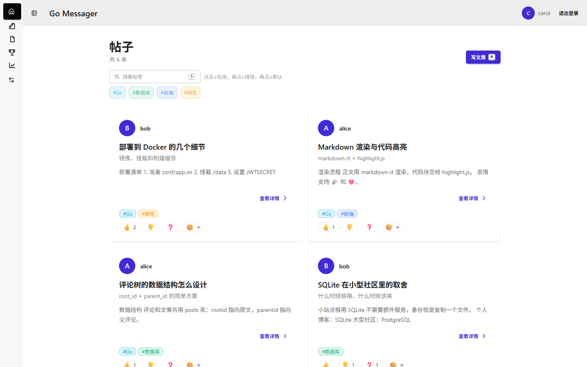
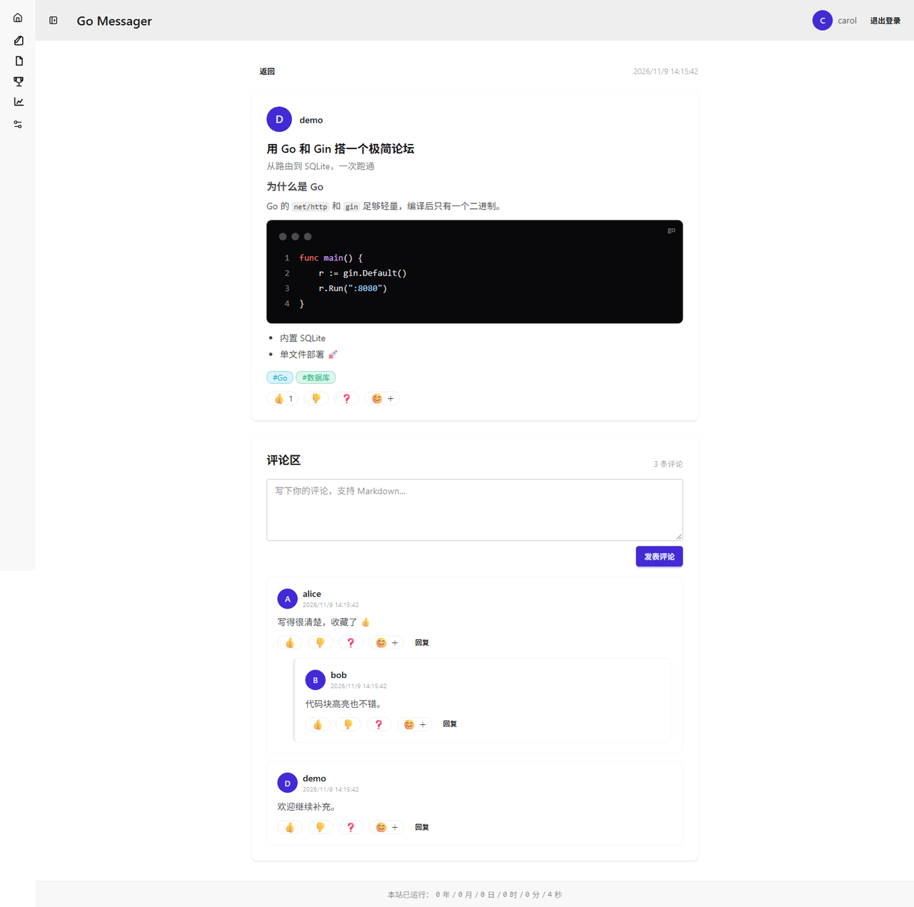
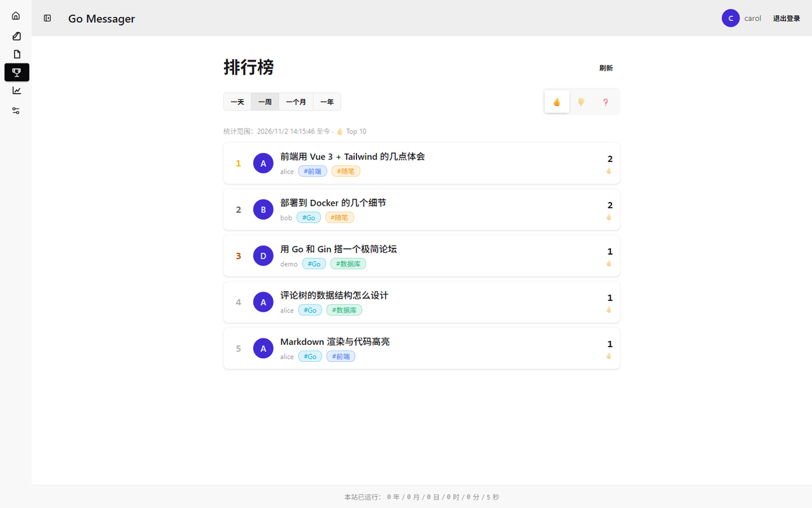
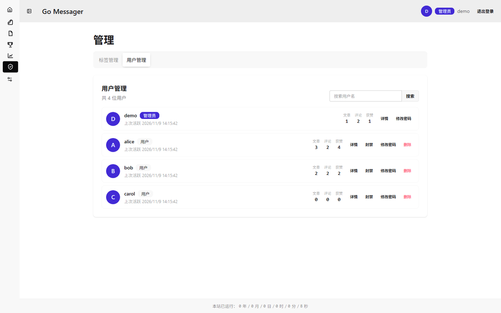

# Go Messager

v0.6.3

Go语言制作的极简论坛

## 界面预览

<table>
  <tr>
    <td valign="top"></td>
    <td valign="top"></td>
  </tr>
  <tr>
    <td valign="top"></td>
    <td valign="top"></td>
  </tr>
</table>

## 配置

默认读取 `conf/app.ini`（已在 `.gitignore` 中，不提交）。首次使用复制最小配置：

```bash
cp conf/app.min.ini conf/app.ini
```

需要完整注释示例时，把 `app.min.ini` 换成 `app.example.ini`。Windows PowerShell：

```powershell
Copy-Item conf/app.min.ini conf/app.ini
```

默认值：

| 配置项          | 默认值           | 说明                                                                        |
| --------------- | ---------------- | --------------------------------------------------------------------------- |
| `server.host`   | 空               | debug 监听 `127.0.0.1`，release 监听 `0.0.0.0`                              |
| `server.port`   | `8080`           | HTTP 端口                                                                   |
| `server.mode`   | `release`        | `debug` / `release` / `test`，留空默认 `release`，`GIN_MODE` 优先           |
| `access.mode`   | `private`        | `private`：所有页面和操作必须登录；`public`：游客可浏览文章，写操作跳转登录 |
| `database.path` | `./data/data.db` | SQLite 文件路径，目录自动创建                                               |
| `jwt.secret`    | 空               | 回退到 `JWT_SECRET` 或数据库自动生成                                        |
| `jwt.ttl`       | `24h`            | `JWT_TTL` 环境变量优先                                                      |
| `captcha.enabled` | `true`         | 注册人机验证开关；关闭后注册接口不再要求验证码 ticket                        |

`access.mode = public` 时，游客可以匿名浏览首页、文章详情、评论列表、标签列表和排行榜；写文章、编辑/删除、点赞等互动、发表评论/回复仍要求登录：切换页面时显示 401 提示页，点赞/评论等互动会弹出登录提示。默认 `private`，所有页面和操作都必须登录。

后端默认开启 gzip 压缩（`gin-contrib/gzip`），对 API JSON 与嵌入的前端静态资源都生效：

- 仅当请求头带 `Accept-Encoding: gzip` 时压缩，并返回 `Vary: Accept-Encoding`；
- `/api/avatar` 以及 `.png`/`.jpg`/`.webp`/`.woff2` 等已压缩内容不重复压缩；
- 4xx/5xx 与无 body 的响应（204/304）不压缩；
- 不使用 `WithMinLength`：该选项在 `gin-contrib/gzip v1.2.9` 中会让 `c.Data` 的小响应出现「声明 gzip、body 明文」，浏览器解码失败。

压缩级别与排除规则在 `middleware.go` 的 `gzipCompression()` 中调整。

JWT 相关环境变量优先级高于配置文件。Docker 镜像用 `conf/app.min.ini` 生成 `/conf/app.ini`，数据库位于 `/data/data.db`，持久化挂载 `/data`。需要自定义配置时挂载 `/conf/app.ini`。

```bash
docker run -d --name go-messager -p 8080:8080 \
  -v go-messager-data:/data \
  -e JWT_SECRET='请替换为随机长字符串' \
  ghcr.io/<owner>/go-messager:latest
```

## 注册人机验证

新用户注册前需要先完成图形验证码，通过后服务端签发一次性 ticket，注册接口凭 ticket 完成创建；全新库初始化首个管理员时豁免，避免首次部署被锁死。

- 前端独立页面 `/verify`：点击图片或「换一张」刷新，显示剩余有效期并在过期后自动换图；验证通过后带 ticket 回到注册页，ticket 存在 `sessionStorage`，有效期 5 分钟且只能用一次。
- 接口：`GET /api/captcha` 返回 PNG data URL 和有效期（2 分钟，答案不落在响应文本里）；`POST /api/captcha/verify` 校验后返回 ticket。
- 防刷：同一道题最多 5 次错误机会；生成 30 次/分钟/IP、校验 20 次/分钟/IP，超出分别返回 `CAPTCHA_TOO_MANY_ATTEMPTS`、`CAPTCHA_RATE_LIMITED`。
- 验证码和 ticket 保存在进程内存中，重启后前端重新验证即可；需要关闭时设置 `[captcha] enabled = false`。

## 维护模式

管理员可在「管理 → 维护模式」开启站点维护：

- 可自定义标题和正文（正文可选）：没有正文时，维护页只显示居中放大的标题。
- 开启后普通用户无法登录、注册，也无法访问任何接口（统一返回 `503` + `MAINTENANCE`）；管理员不受影响。
- 管理员在管理页关闭后立即恢复；停留在维护页的用户每 15 秒自动检测，恢复后跳回首页。
- 状态保存在数据库 `settings` 表（key 为 `maintenance`），重启后保留。

维护期间仍可访问的接口：`GET /api/status`（维护页和前端守卫读取状态）、`GET /api/uptime`（容器健康检查）、`GET /api/captcha` 与 `POST /api/captcha/verify`（注册页取题和校验）、`POST /api/authorize`（管理员登录以恢复站点）、`POST /api/register`（仅当数据库还没有用户时用于初始化管理员，其余情况返回 503）。

## 镜像构建

CI 在推送 `vX.Y.Z` 标签时构建并推送镜像，发布版本标签（如 `0.5.0`）和 `latest`；在 Actions 页面手动触发时只推送 `latest`（见 `.gitea/workflows/Build-Docker.yml`）。本地构建：

```bash
docker build -t go-messager:local .
```

Dockerfile 没有使用 `# syntax=docker/dockerfile:1`，避免构建开始前还要从 docker.io 拉取 dockerfile frontend；自带 frontend（Docker 20.10+ / BuildKit 0.8+）已支持 `RUN --mount=type=cache`。

CI 直接调用 runner 上 Docker 引擎自带的 builder（`docker` driver），不使用 QEMU，**只构建 runner 本机架构**（amd64 runner 产出 amd64 镜像）。

npm / pnpm 的依赖默认走 `https://registry.npmmirror.com`（Dockerfile 里的 `ARG NPM_REGISTRY`），需要官方源或私有源时：

```bash
docker build --build-arg NPM_REGISTRY=https://registry.npmjs.org -t go-messager:local .
```

CI 中可通过仓库「Settings → Variables」覆盖以下变量：

| 变量                | 默认值                           | 说明                             |
| ------------------- | -------------------------------- | -------------------------------- |
| `REGISTRY`          | `ghcr.io`                        | 镜像仓库地址                     |
| `IMAGE_NAME`        | `ghcr.io/<owner>/<repo>`         | 完整镜像名                       |
| `REGISTRY_USERNAME` | 当前触发用户                     | 登录镜像仓库的用户名             |
| `GOPROXY`           | `https://goproxy.cn,direct`      | Go 模块代理，作为 build-arg 传入 |
| `GOSUMDB`           | `sum.golang.google.cn`           | Go 校验库，作为 build-arg 传入   |
| `NPM_REGISTRY`      | `https://registry.npmmirror.com` | npm / pnpm 依赖镜像源            |

登录镜像仓库的密码在 Secrets 配置 `REGISTRY_PASSWORD`（缺省回退 `GITEA_TOKEN` / `GITHUB_TOKEN`）。

# TODO

1. [x] 卡片悬浮
2. [x] text-rotate
3. [x] countdown
4. [x] 排行(问号)榜
5. [x] emoji和表情
6. [x] Markdown支持
7. [x] 个人帖子界面
8. [x] 管理员隐藏或删除帖子
9. [x] 管理员查看数据统计：折线统计图，标签饼图，登陆人数
10. [x] md 短emoji
11. [x] 404界面
12. [ ] 公告和维护模式
13. [x] 配置读取逻辑优化
14. [x] 隐私模式和公开模式
15. [x] 最小配置/docker配置
16. [x] 等级系统 lkhsss/go-messager#1
17. [ ] 用户管理界面显示等级和经验条
18. [x] 一键清除某个用户文章

# FIXME

1. [x] 前端js分割
